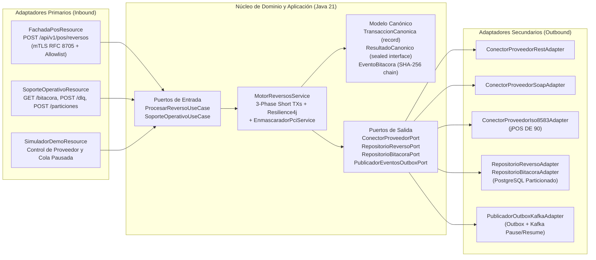
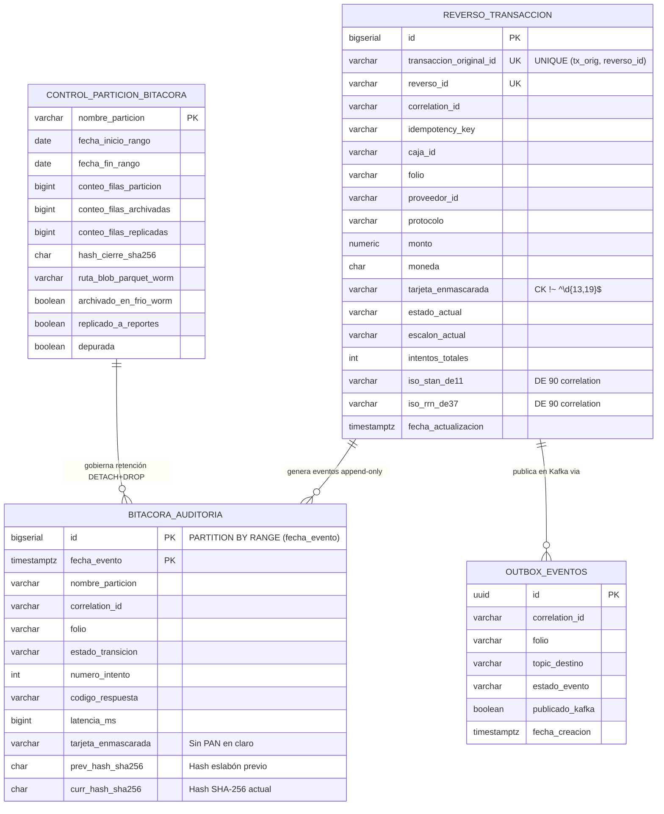
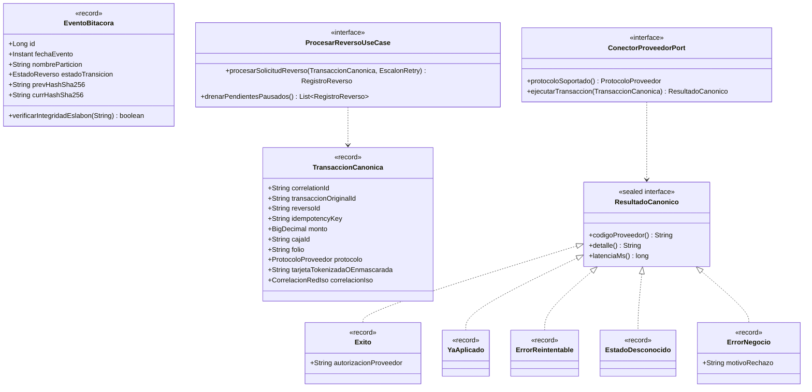
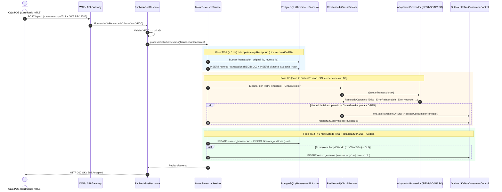

# Piloto Local: Motor Genérico de Transacciones y Servicio de Reversos POS en ARO

Repositorio del piloto funcional para validar las opciones de arquitectura **Op1 (Todo en ARO)** y **Op3 (Híbrido: Kafka y Quarkus en ARO + PostgreSQL Flexible Server en Azure)** descritas en [propuesta-arquitectura-integracion-pos-aro.md](file:///D:/Projects/Arquitectura%20XPOS-SE/propuesta-arquitectura-integracion-pos-aro.md) y retadas técnicamente en [reto-tecnico-y-mejoras-arquitectura.md](file:///D:/Projects/Arquitectura%20XPOS-SE/reto-tecnico-y-mejoras-arquitectura.md).

---

## 1. Especificación Funcional

El servicio resuelve el procesamiento resiliente, idempotente y auditable bajo estándar PCI-DSS de las solicitudes de reverso originadas por ~50,000 puntos de venta (POS) hacia proveedores externos multiprotocolo (`REST`, `SOAP`, `ISO 8583`):

1. **Puerta única hacia el POS (Fachada Quarkus):** Las cajas nunca se conectan a Kafka. Envían su solicitud a `/api/v1/pos/reversos` con su certificado mTLS (`X-Forwarded-Client-Cert`, validado contra el claim `RFC 8705` `cnf.x5t#S256`) y su `Idempotency-Key`.
2. **Clasificación Canónica de Respuestas:** Todo proveedor responde mediante un adaptador que traduce la respuesta a una de las 5 clases de `ResultadoCanonico`:
   - `Exito`: Reverso confirmado.
   - `YaAplicado`: El proveedor reporta que la transacción ya fue reversada previamente; se trata como éxito idempotente.
   - `ErrorReintentable`: Falla técnica transitoria (5xx, caída de socket); dispara reintentos inmediatos con backoff y, de agotarse con circuito cerrado, escalones diferidos (`reverso.retry.1m`, `.5m`, `.30m`).
   - `EstadoDesconocido`: Timeout de lectura post-envío; nunca dispara un reenvío ciego, sino consulta previa / reverso `0421` con preservación de `DE 90`.
   - `ErrorNegocio`: Rechazo definitivo del autorizador (`422` / `DE39=12`); no se reintenta y pasa directo a `reverso.dlq` (`DLQ_INTERVENCION_MANUAL`).
3. **Pausa Automática de Consumidor ante Caída de Proveedor (RT-02):** Cuando el Circuit Breaker pasa a `OPEN`, el consumidor de Kafka pausa sus particiones para no quemar los escalones de retry ni saturar la DLQ; al recuperarse el proveedor (`HALF_OPEN` -> `CLOSED`), reanuda y drena los pendientes sin duplicados.
4. **Bitácora Append-Only con Cadena SHA-256 y Depuración Segura (`DETACH + DROP`):** Cada transición se registra sin PAN en claro, encadenada con hash SHA-256 (`prev_hash -> curr_hash`). El job de mantenimiento solo ejecuta `DETACH + DROP` si la partición está archivada en Blob Storage Parquet (WORM), replicada a reportes comerciales y con conteos y checksum coincidentes.

---

## 2. Especificación Técnica y Diagrama de Arquitectura Hexagonal

* **Lenguaje y Runtime:** Java 21 LTS (`records`, `sealed interfaces`, `Pattern Matching for switch`, `@RunOnVirtualThread`) sobre **Quarkus 3.15 LTS**.
* **Resiliencia:** `Resilience4j` (`CircuitBreaker` + `Retry`) con listener reactivo de transición de estado.
* **Base de Datos y Migraciones:** PostgreSQL 16 con particionamiento declarativo (`PARTITION BY RANGE (fecha_evento)`), `fillfactor=100`, índices `BRIN` + `B-tree` locales y migraciones automatizadas con **Flyway**.



---

## 3. Modelo de Datos (ER Diagram)

Separación física entre la tabla de estado/idempotencia global (`reverso_transaccion`) y la bitácora append-only particionada por rango de fecha (`bitacora_auditoria`) para evitar la brecha de unicidad entre particiones (**RT-05**).



---

## 4. Diagrama de Clases (Dominio y Puertos en Java 21)



---

## 5. Diagrama de Secuencia (Flujo de 3 Fases Cortas + Circuit Breaker + Outbox)



---

## 6. Códigos de Estado (HTTP, Canónicos y de Dominio)

| Código | Categoría | HTTP Status | Acción en el Motor / Descripción |
| :--- | :--- | :---: | :--- |
| `EXITOSO` | Estado Dominio (`Exito`) | `200 OK` | Reverso confirmado por el proveedor; se sella en bitácora |
| `YA_APLICADO` | Estado Dominio (`YaAplicado`) | `200 OK` | Idempotente: el proveedor confirma que ya estaba reversado |
| `REINTENTO_DIFERIDO` | Estado Dominio (`ErrorReintentable`) | `202 Accepted` | Agotó reintentos inmediatos; pasa a `reverso.retry.1m` / `.5m` / `.30m` o espera en cola pausada |
| `ESTADO_DESCONOCIDO_CONSULTA` | Estado Dominio (`EstadoDesconocido`) | `202 Accepted` | Timeout post-envío; dispara consulta previa o reverso `0421` con `DE 90` |
| `DLQ_INTERVENCION_MANUAL` | Estado Dominio (`ErrorNegocio` / Fin retries) | `202 Accepted` | Rechazo definitivo o ventana vencida; visible en `/api/v1/soporte/dlq` |
| `SEC-PCI-002` | Seguridad PCI-DSS (P2) | `400 Bad Request` | Rechazo inmediato por intento de enviar un PAN en claro (13–19 dígitos) |
| `SEC-MTLS-8705-002` | Seguridad POS (P3 / RT-01) | `403 Forbidden` | El certificado cliente en `X-Forwarded-Client-Cert` no coincide con el claim `cnf.x5t#S256` |
| `ERR-404-NO-ENCONTRADO` | Soporte Operativo | `404 Not Found` | Folio, `reversoId` o partición no encontrada |
| `ERR-409-ESTADO-INVALIDO` | Soporte DLQ | `409 Conflict` | Intento de reprocesar manualmente un reverso que ya fue exitoso |
| `ERR-412-DEPURACION-BLOQUEADA` | Mantenimiento Bitácora | `412 Precondition Failed` | Bloqueo de seguridad: el job `DETACH + DROP` detectó que falta el archivo frío WORM, falta la réplica a reportes o los conteos de filas no coinciden |

---

## 7. Runbook Operativo y Ejecución del Piloto

### 7.1 Ejecución Rápida de Pruebas Automatizadas (Sin requerir Docker)
Valida los 6 pasos del guion de demo y las reglas de seguridad PCI-DSS / mTLS en segundos:
```powershell
mvn clean test
```

### 7.2 Levantar el Piloto en Modo Local Standalone (Sin Docker) y Ejecutar el Guion de Demo
```powershell
# Terminal 1: Iniciar Quarkus en modo dev/standalone
mvn quarkus:dev

# Terminal 2: Ejecutar el guion interactivo de 6 pasos
.\scripts\demo-guion-6-pasos.ps1
```
Swagger UI estará disponible en: `http://localhost:8080/q/swagger-ui`

### 7.3 Levantar Perfil Op1 (Todo en ARO) o Perfil Op3 (Híbrido con Azure PostgreSQL Flexible) en Docker Compose
```powershell
# Empaquetar la aplicación Quarkus
mvn clean package -DskipTests

# Opción A: Levantar Perfil Op1 (Todo en la red del clúster ARO)
docker compose -f docker-compose.op1.yml up -d

# Opción B: Levantar Perfil Op3 (Kafka+Quarkus en ARO, PostgreSQL en red separada Azure Flexible)
docker compose -f docker-compose.op3.yml up -d

# Ejecutar el mismo guion de demo contra cualquiera de los dos perfiles sin tocar código
.\scripts\demo-guion-6-pasos.ps1
```

### 7.4 Procedimiento Operativo ante Alertas de Producción (Runbook)
1. **Alerta: `CircuitBreakerStateOpen` / `KafkaConsumerPaused` en un proveedor:**
   - **Diagnóstico:** Consultar `GET /api/v1/simulador/estado` (o métricas Prometheus `resilience4j_circuitbreaker_state`). El consumidor de Kafka se pausa automáticamente para proteger los mensajes en el topic principal.
   - **Acción:** No reiniciar los pods ni forzar el escalado en KEDA. Una vez que el proveedor restablezca su servicio, el Circuit Breaker pasará a `HALF_OPEN` y luego a `CLOSED`, drenando la cola automáticamente.
2. **Alerta: Transacciones acumuladas en `reverso.dlq` (`DLQ_INTERVENCION_MANUAL`):**
   - **Diagnóstico:** Consultar `GET /api/v1/soporte/dlq` y revisar la cadena de eventos con `GET /api/v1/soporte/bitacora/{folio}`.
   - **Acción:** Tras validar con el autorizador externo, invocar `POST /api/v1/soporte/dlq/{reversoId}/reprocesar` indicando `operadorSoporte` y `motivo`.
3. **Alerta: `ERR-412-DEPURACION-BLOQUEADA` en el job de mantenimiento de bitácora:**
   - **Diagnóstico:** Consultar `GET /api/v1/soporte/particiones`. Identificar si `archivadoEnFrioWorm` o `replicadoAReportes` está en `false`, o si existe diferencia entre `conteoFilasParticion`, `conteoFilasArchivadas` y `conteoFilasReplicadas`.
   - **Acción:** Re-ejecutar el pipeline de extracción en Data Factory / DataStage desde la réplica de lectura (`v_reportes_comerciales_reversos`), actualizar la confirmación y volver a invocar `POST /api/v1/soporte/particiones/{nombreParticion}/depurar`.
