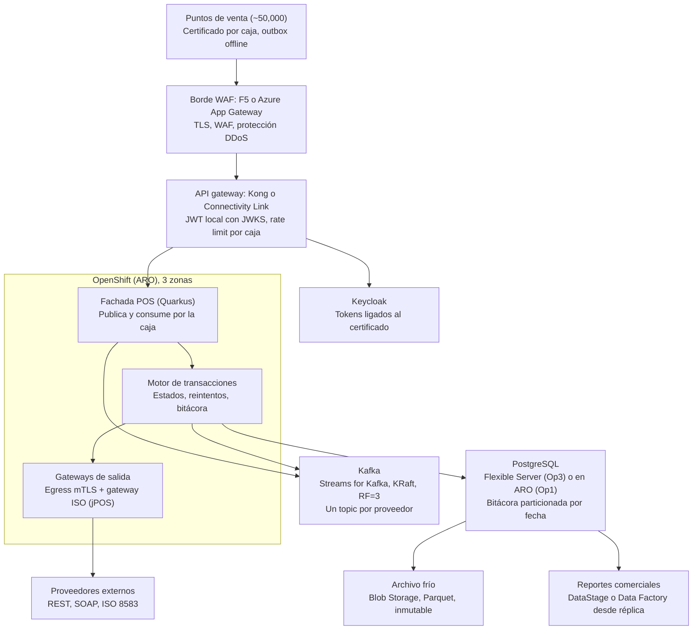

# Propuesta de arquitectura: plataforma de integración POS en ARO

Fecha: 2026-10-15 · Autor: Roberto

## Control del documento

Borrador para revisión de arquitectura, seguridad e infraestructura; no es todavía un estándar aprobado.

| Campo | Valor |
| --- | --- |
| Versión | 0.2 (revisada tras reto técnico y piloto local) |
| Estado | En validación con piloto local ([reto-tecnico-y-mejoras-arquitectura.md](file:///D:/Projects/Arquitectura%20XPOS-SE/reto-tecnico-y-mejoras-arquitectura.md)) |
| Audiencia | Arquitectura, seguridad de la información, infraestructura cloud, equipos de integración y soporte |
| Alcance | Plataforma de integración entre ~50,000 puntos de venta, servicios centrales en ARO y proveedores externos |
| Fuera de alcance | Implementación productiva del monitoreo en Datadog, diseño detallado del ciclo de vida de certificados de caja |

Lenguaje normativo: DEBE indica un requisito obligatorio, DEBERÍA una recomendación fuerte que requiere justificación para no seguirse, y PUEDE una opción permitida.

## Resumen ejecutivo

Se recomienda la opción híbrida (Op3): Kafka y servicios Quarkus en ARO, PostgreSQL administrado en Azure, con validación funcional en pilotos locales de Op1 y Op3 antes de decidir con datos de costo y latencia.

Decisiones clave de la propuesta:

- Las cajas DEBEN tener una sola puerta de entrada (borde WAF + un API gateway) y NO DEBEN conectarse directamente a Kafka; una fachada Quarkus publica y consume por ellas.
- La identidad de cada caja DEBE basarse en un certificado propio con llave no exportable; Keycloak emite tokens ligados a ese certificado, sin secretos compartidos en la caja.
- La nube NO DEBE estar en la ruta crítica de venta: la tienda sigue vendiendo sin WAN.
- Las transacciones con proveedores externos se procesan con un motor genérico (estados, reintentos, idempotencia, bitácora) y adaptadores por protocolo (REST, SOAP, ISO 8583) configurables por proveedor.
- La bitácora de auditoría se particiona por fecha, se depura por partición con retención configurable y se replica a reportes comerciales por extracción incremental desde la réplica.

En la matriz preliminar, Op3 obtiene 4.10 de 5, Op1 3.90 y Op2 3.40; la diferencia entre Op1 y Op3 es pequeña y la decide el costo mensual medido en el piloto.

## Principios y requisitos

Cuatro principios gobiernan todas las decisiones del documento; una opción que viole cualquiera de ellos se descarta.

| ID | Principio | Requisito |
| --- | --- | --- |
| P1 | Offline-first | La tienda DEBE seguir vendiendo con la nube, el WAN o un proveedor caídos; la caja DEBE guardar sus operaciones en un outbox local con store-and-forward. |
| P2 | Cumplimiento PCI-DSS | Ningún dato de tarjeta en claro en topics, logs ni bases de datos; el CDE DEBE aislarse con namespaces, node pools y NetworkPolicies dedicados. |
| P3 | Sin credenciales en la caja | La caja NO DEBE almacenar secretos compartidos; la administración de credenciales DEBE ser mínima y automatizada. |
| P4 | Alta disponibilidad con costo optimizado | Los componentes con estado DEBEN distribuirse en 3 zonas; la capacidad DEBERÍA escalar por demanda en lugar de reservarse para el pico. |

Estándares homologados que aplican: Quarkus LTS (Jakarta EE 10, MicroProfile), Resilience4j para resiliencia, CyberArk Conjur para secretos (sidecar), Bytebase para cambios de base de datos, Checkmarx para análisis de seguridad y Datadog para observabilidad.

## Arquitectura de referencia

Cajas y proveedores externos entran por un único borde WAF; los servicios Quarkus en ARO son los únicos que hablan con Kafka, PostgreSQL y los proveedores.



Roles de los gateways, sin apilarlos: el borde (F5 o Azure App Gateway) filtra; un solo API gateway (Kong o Connectivity Link) autentica y limita el tráfico de entrada; el egress gateway y el gateway ISO concentran la salida hacia proveedores con mTLS.

## Seguridad del punto de venta

Cada caja se autentica con su propio certificado y recibe tokens de vida corta ligados a ese certificado; ningún secreto compartido vive en la caja.

- Identidad del dispositivo: certificado por caja con llave no exportable (TPM o keystore del sistema operativo), de vida corta y con rotación automática.
- Emisión de tokens: Keycloak DEBE emitir tokens ligados al certificado (mTLS, RFC 8705, claim `cnf.x5t#S256`) o usar `private_key_jwt`; NO DEBEN usarse client secrets compartidos.
- Preservación de identidad en el borde (RT-01): el borde WAF que termina TLS DEBE limpiar cualquier cabecera `X-Forwarded-Client-Cert` (XFCC) entrante, inyectar el thumbprint SHA-256 del certificado hoja validado y comunicarse con el API gateway sobre mTLS interno estricto.
- Validación en el gateway: el API gateway DEBE validar el JWT localmente con JWKS en caché y verificar criptográficamente la correspondencia entre el thumbprint XFCC y el claim `cnf.x5t#S256`, para que Keycloak no esté en la ruta de cada transacción.
- Apertura masiva de tiendas: el refresh de tokens DEBE llevar jitter, y el rate limit DEBE aplicarse por terminal, no global.
- Acceso a mensajería (RT-06): las cajas NO DEBEN conectarse a Kafka ni mantener 50,000 streams SSE abiertos permanentemente (evitando agotamiento de puertos SNAT). Una fachada Quarkus recibe operaciones vía REST (`202 Accepted` con `Idempotency-Key`) y ofrece reconciliación asíncrona por lote con jitter.
- Integridad en caja: outbox local e idempotency keys, para que un reintento nunca duplique un cobro.

Pendiente de diseño propio: el ciclo de vida de ~50,000 certificados (enrolamiento, renovación y revocación).

## Opciones de despliegue

Las tres opciones comparten Quarkus en ARO y la misma seguridad de caja; difieren en dónde vive el estado y quién lo opera, que es el principal factor de costo porque cada worker de ARO paga la VM más la licencia de OpenShift.

| Aspecto | Op1: todo en ARO | Op2: servicios administrados de Azure | Op3: híbrido (recomendada) |
| --- | --- | --- | --- |
| Kafka | Streams for Kafka en ARO | Event Hubs con endpoint Kafka | Streams for Kafka en ARO |
| PostgreSQL | CloudNativePG o Crunchy en ARO | Azure Database for PostgreSQL Flexible, zone-redundant | Azure Database for PostgreSQL Flexible, zone-redundant |
| Gateway | Connectivity Link o Kong | Azure App Gateway o APIM | F5 en el borde + un solo gateway |
| Keycloak | Red Hat build of Keycloak en ARO | Red Hat build of Keycloak en ARO | Red Hat build of Keycloak en ARO |
| Rendimiento | Mejor latencia; control total de Kafka | Predecible; un salto de red extra y límites por unidad de throughput | Kafka cerca de los consumidores; PgBouncer y réplicas de lectura |
| Costo | Sin cargos por throughput; más workers con licencia y más operación | Clúster mínimo; pago por capacidad que crece con picos sostenidos | Workers solo para Kafka y servicios; PostgreSQL sin carga operativa |
| Riesgo principal | Carga operativa (upgrades, backups, DR) | Event Hubs no es Kafka completo; lock-in; alcance PCI del servicio | Dos modelos de operación conviviendo |

Antes de cerrar la comparación de costo, se DEBE confirmar si la suscripción de Red Hat ya incluye Streams for Kafka y Red Hat build of Keycloak.

Optimizaciones comunes a las tres opciones:

- Quarkus con Java 21 LTS (Virtual Threads `@RunOnVirtualThread` para adaptadores I/O, records y sealed interfaces); nativo para servicios que escalan o arrancan seguido y JVM comparado en el piloto para los de throughput sostenido.
- KEDA escalando consumidores por lag de Kafka combinado con el estado del Circuit Breaker (RT-02: no escalar pods si el circuito hacia el proveedor está `OPEN`).
- Kafka con KRaft, `RF=3`, `min.insync.replicas=2`, rack awareness, compresión `zstd` o `lz4` y batching del productor.
- Node pools separados para cargas PCI y no PCI; spot solo para cargas no críticas, instancias reservadas para Kafka.

## Matriz de evaluación

Con calificaciones preliminares, Op3 suma 4.10 de 5, Op1 3.90 y Op2 3.40; cada calificación se reemplaza con la medición del piloto.

Filtros eliminatorios, previos a la puntuación: cumplir P1 (offline-first), P2 (sin datos de tarjeta en claro, CDE aislado) y P3 (sin credenciales compartidas en caja). Una opción que no los cumpla se descarta.

| Criterio | Peso | Op1 | Op2 | Op3 | Cómo se mide en el piloto |
| --- | --- | --- | --- | --- | --- |
| Costo mensual (infra + licencias) | 20 | 3 | 3 | 4 | Proyección a 50k cajas, normalizada como costo por millón de transacciones |
| Latencia p99 | 15 | 5 | 3 | 4 | Punta a punta (caja → gateway → Quarkus → Kafka → acuse), en carga normal y en pico, contra el SLA |
| HA (RTO/RPO) | 15 | 3 | 5 | 4 | Chaos testing: caída de zona, broker, primario de PostgreSQL y pod de Keycloak; mensajes perdidos o duplicados |
| PCI y control de datos | 15 | 5 | 3 | 4 | Alcance del CDE, evidencia de segmentación y cifrado, custodia de llaves |
| Throughput en picos | 10 | 5 | 3 | 5 | Simulación de apertura masiva más pico de pagos: lag máximo de Kafka y tiempo de recuperación |
| Costo de operación | 10 | 2 | 5 | 4 | Horas al mes de upgrades, parches, backups, DR y guardias, convertidas a FTE |
| Compatibilidad Kafka | 5 | 5 | 2 | 5 | Transacciones, compaction, Kafka Streams y rebalanceo de consumer groups |
| Portabilidad / lock-in | 5 | 5 | 1 | 3 | Componentes a reescribir o reemplazar para salir de Azure |
| Elasticidad | 5 | 3 | 4 | 4 | Tiempo de KEDA de mínimo a pico y de regreso; capacidad ociosa fuera de horario |
| Total ponderado (de 5) | 100 | 3.90 | 3.40 | 4.10 | Suma de calificación × peso / 100 |

Si el equipo de operación es pequeño, el peso de costo de operación DEBERÍA subir y la matriz recalcularse.

## Motor genérico de transacciones

Un núcleo único resuelve estados, reintentos, idempotencia y bitácora para todos los tipos de transacción; cada proveedor solo aporta un adaptador de protocolo y su configuración.

### Modelo canónico

- Transacción canónica: tipo, operación (venta, reverso, consulta), monto, moneda, caja, folio, llave de idempotencia, bloque inmutable de correlación de red ISO (`DE 90`: MTI original, STAN, DE 7, RRN DE 37, adquirente DE 32) y un mapa de metadatos para lo específico.
- Resultado canónico (`sealed interface` en Java 21): todo proveedor responde en una de cinco clases: `Exito`, `ErrorReintentable`, `ErrorNegocio`, `YaAplicado` o `EstadoDesconocido`.
- El estado desconocido (timeout después de enviar) DEBE tratarse aparte del error reintentable: dispara consulta previa o estrategia de reverso idempotente, nunca un reenvío ciego que pueda duplicar el cargo.

### Núcleo

- Máquina de estados, reintentos inmediatos y diferidos, circuit breaker con Resilience4j, idempotencia, DLQ y bitácora.
- Las decisiones se toman sobre la clase canónica, nunca sobre códigos del proveedor.
- Se empaqueta como librería o extensión de Quarkus versionada, candidata a arquetipo en PRIME.

### Adaptadores por protocolo

| Protocolo | Tecnología | Consideraciones |
| --- | --- | --- |
| REST | Quarkus REST Client | OAuth o mTLS por proveedor |
| SOAP | Quarkus CXF | WS-Security cuando aplique |
| ISO 8583 | jPOS en un gateway ISO compartido | Orientado a conexión: sign-on, echo 0800, STAN y RRN, persistencia de `DE 90` para reversos `0420`/`0421` entre pods (RT-07), multiplexado, límite de sockets; protección de campos sensibles como DE 63 |

Los adaptadores solo traducen y clasifican la respuesta; NO DEBEN contener lógica de reintentos.

### Configuración por proveedor y tipo de transacción

- Conexión: protocolo, endpoint, timeouts y autenticación (alias de certificado o cliente OAuth en Conjur).
- Política de reintentos: intentos inmediatos, escalones diferidos y ventana máxima de reverso; vencida la ventana, la transacción pasa a intervención manual.
- Umbrales del circuit breaker.
- Tabla de códigos: código del proveedor → clase canónica.
- Estrategia de reverso: directo, consulta previa o repetición tipo 0420.
- Reglas de enmascaramiento para la bitácora.

La configuración DEBE vivir en Git como YAML con esquema validado al arrancar (GitOps), para que cada cambio quede revisado y trazable. Solo los parámetros no sensibles PUEDEN recargarse en caliente. Regla de límite: el formato y los códigos se configuran; el protocolo se programa.

### Aislamiento

- Un topic de solicitudes y reintentos por proveedor (`txn.solicitud.<proveedor>`), para que pausar el consumidor de un proveedor caído no detenga a los demás.
- Un microservicio por proveedor o grupo de proveedores sobre el mismo núcleo, desplegable y escalable de forma independiente.

### Alta de un proveedor nuevo

1. Protocolo existente: solo configuración (endpoint, tabla de códigos, política).
2. Formato distinto: un mapper dentro del adaptador existente.
3. Protocolo nuevo: un adaptador que implementa el puerto `ConectorProveedor`; el núcleo no cambia.

## Servicio de reversos

El servicio de reversos es el primer caso del motor genérico: todo reverso termina confirmado o visible para soporte, nunca abandonado en silencio.

### Flujo y gestión transaccional en 3 fases (RT-02, RT-03, RT-05)

1. La solicitud llega por Kafka (`pagos.reverso.solicitado`), originada por un timeout sin respuesta o por una cancelación.
2. **Fase TX-1 (Recepción e Idempotencia, < 5 ms):** Se verifica e inserta la clave única `(transaccion_original_id, reverso_id)` en la tabla de estado `reverso_transaccion` (separada de la bitácora particionada para garantizar unicidad global incluso al cruzar medianoche, RT-05) junto con el evento `RECIBIDO` en `bitacora_auditoria`. Se hace commit inmediato para liberar la conexión de PostgreSQL antes de hacer I/O de red (RT-03).
3. **Fase I/O (Sin retener conexión DB):** Clasificación de la respuesta del proveedor sobre Java 21 Virtual Threads: timeout, 5xx o falla de conexión son reintentables; los errores de negocio no se reintentan, salvo "ya reversada" (`YaAplicado`), que cuenta como éxito.
4. Reintentos inmediatos con Resilience4j: pocos intentos, backoff exponencial con jitter y circuit breaker.
5. **Fase TX-2 (Resolución, Bitácora y Outbox, < 5 ms):** En una sola transacción corta se actualiza `reverso_transaccion`, se inserta el evento en `bitacora_auditoria` y se registra el mensaje en `outbox_eventos`.
6. Reintentos diferidos: cuando el circuito está `CLOSED` pero una transacción individual agota los reintentos inmediatos, pasa a topics de espera (`reverso.retry.1m`, `.5m`, `.30m`).
7. Al agotar todos los escalones o vencer la ventana del proveedor, el reverso va a `reverso.dlq` con estado de intervención manual (`DLQ_INTERVENCION_MANUAL`).

**Coordinación Circuit Breaker y Pausa de Kafka (RT-02):** Cuando el circuit breaker se abre (`OPEN`), el consumidor DEBE pausar sus particiones del topic principal para no quemar los escalones de retry mientras el proveedor está caído. Con `automaticTransitionFromOpenToHalfOpenEnabled=true`, al pasar a `HALF_OPEN` el listener de estado reanuda el consumidor para permitir las llamadas sonda; si tienen éxito, el circuito se cierra (`CLOSED`) y drena lo pendiente; si fallan, vuelve a `OPEN` y re-pausa.

### Bitácora de auditoría y soporte

- Tabla `bitacora_auditoria` append-only particionada por fecha con cada transición de estado (`RECIBIDO`, `INTENTO_N`, `EXITOSO`, `YA_APLICADO`, `REINTENTO_DIFERIDO`, `DLQ_INTERVENCION_MANUAL`): timestamp, correlation id, caja, folio, tipo, proveedor, protocolo, código de respuesta y latencia.
- NO DEBE contener PAN en claro; solo valores enmascarados o tokenizados validados al ingreso.
- El usuario de la aplicación DEBE tener solo permiso de INSERT sobre `bitacora_auditoria`.
- **Cadena de hashes sin contención global (RT-04):** Cada registro incluye el hash SHA-256 encadenado al evento anterior dentro del mismo agregado (`correlation_id` / `folio`), evitando bloqueos globales de escritura; al cerrar cada partición, el job de mantenimiento sella el hash acumulado (Merkle/Root hash) de toda la partición en `control_particion_bitacora`.
- El cambio de estado y la bitácora DEBEN escribirse en la misma transacción corta (TX-2); la publicación de eventos usa la tabla `outbox_eventos`.
- Soporte: endpoints para consultar por folio o correlation id y para reprocesar desde la DLQ, protegidos con un rol de Keycloak.

## Mantenimiento y retención de la bitácora

La bitácora se particiona por fecha y se depura quitando particiones completas (DETACH + DROP), nunca con DELETE masivo, para que el crecimiento no degrade la base.

### Particionamiento

- Partición nativa de PostgreSQL por rango de fecha de registro (`PARTITION BY RANGE (fecha_evento)`): mensual con volumen moderado, diaria o semanal si una partición mensual supera decenas de GB.
- Automatización con `pg_partman` y `pg_cron` (habilitados en `azure.extensions` y `shared_preload_libraries` en Flexible Server), creando particiones futuras por adelantado.
- Alerta si algún registro cae en la partición default.

### Retención en niveles

| Nivel | Dónde | Retención |
| --- | --- | --- |
| Caliente | PostgreSQL | N meses configurables; si la bitácora es audit trail en alcance PCI, no menos de 3 |
| Payload crudo | Tabla separada en PostgreSQL | Más corta, por ejemplo 30 a 90 días |
| Frío | Blob Storage en Parquet, con inmutabilidad (WORM) y lifecycle cool/archive | Hasta cumplir la retención total; PCI DSS pide 12 meses de historial de auditoría |

Configuración de referencia, en el mismo repositorio GitOps:

```yaml
bitacora:
  particion: mensual
  retencion_caliente_meses: 6
  retencion_payload_dias: 60
  retencion_total_meses: 13
  particiones_futuras: 3
```

### Depuración segura

- Una tabla de control registra por partición si ya se archivó y si ya se replicó a reportes, con conteo de filas y checksum.
- El job de mantenimiento DEBE hacer DETACH y DROP solo si la partición está archivada, replicada y con conteos coincidentes; si falta algo, no borra y alerta.
- La cadena de hashes, si se usa, se cierra por partición y su hash final se guarda en la tabla de control y en el manifiesto del archivo frío.

### Replicación a reportes comerciales (DataStage o Data Factory)

- Extracción incremental por marca de agua (id o fecha de registro monótonos), sin lecturas completas.
- La extracción DEBE leer de la réplica, no del primario.
- Índice BRIN sobre la fecha y partition pruning, para tocar solo las particiones recientes.
- Vista de reporte sin payload ni datos sensibles, que mantiene los reportes fuera del alcance PCI.
- El proceso de réplica escribe su confirmación en la tabla de control, lo que habilita la depuración.

### Higiene de la base

- Mínimo de índices: locales por partición, BRIN en fecha y B-tree solo en correlation id y folio.
- `fillfactor 100`, porque no hay updates.
- Autovacuum ajustado para inserción y freeze proactivo de particiones cerradas.
- Monitoreo de tamaño por partición, crecimiento diario y retraso de la réplica.

Dimensionamiento: transacciones por día × eventos por transacción × tamaño de fila, más el payload aparte; un día real del piloto permite fijar N con datos.

## Estrategia de despliegue CI/CD, GitOps y repositorios

El detalle completo de pipelines, compuertas DevSecOps y políticas de promoción se documenta en [propuesta-despliegue-cicd-gitops-aro.md](file:///D:/Projects/Arquitectura%20XPOS-SE/propuesta-despliegue-cicd-gitops-aro.md).

### Principios de entrega continua en alcance PCI-DSS

- Separación estricta entre CI y CD: GitHub Actions compila con Java 21, ejecuta pruebas, analiza seguridad con Checkmarx (SAST/SCA), SonarQube y Trivy, genera SBOM CycloneDX, firma la imagen OCI con Cosign y abre un PR con el digest inmutable (`@sha256`) hacia el repositorio GitOps. Ningún runner de CI tiene permisos directos de administrador sobre el clúster productivo de ARO.
- Despliegue Pull-Based con OpenShift GitOps (ArgoCD) y Argo Rollouts: sincronización declarativa en las 3 zonas de ARO con liberación progresiva (Canary 10% → 50% → 100%) y rollback automático si la latencia p99 o la tasa de error superan el umbral.
- Gobierno de base de datos con Bytebase: en producción el usuario de aplicación NO ejecuta DDL; Bytebase valida que ningún cambio contenga `DELETE` sobre `bitacora_auditoria` y aplica las migraciones y particiones antes del rollout de la aplicación.
- Cero secretos en Git: toda credencial o certificado de proveedor se referencia por alias y se inyecta en tiempo de ejecución desde CyberArk Conjur.

### Topología de repositorios en GitHub

| Repositorio | Tipo | Alcance |
| --- | --- | --- |
| [`xpos-core-motor-transacciones`](https://github.com/castellconde/xpos-core-motor-transacciones) | Librería / Arquetipo Quarkus (Java 21) | Modelo canónico (`TransaccionCanonica`, `ResultadoCanonico`), puertos hexagonales, hash encadenado SHA-256 y sanitizador PCI-DSS |
| [`xpos-ms-fachada-pos`](https://github.com/castellconde/xpos-ms-fachada-pos) | Microservicio Quarkus (Java 21) | Fachada única para ~50,000 cajas POS, validación mTLS XFCC (`RFC 8705`), `Idempotency-Key` y publicación hacia Kafka |
| [`xpos-ms-motor-reversos`](https://github.com/castellconde/xpos-ms-motor-reversos) | Microservicio Quarkus (Java 21) + Piloto | Motor de reversos, adaptadores REST/SOAP/ISO-8583 (`jPOS`), coordinación Circuit Breaker + pausa de Kafka, DLQ y depuración de particiones |
| [`xpos-infra-aro-terraform`](https://github.com/castellconde/xpos-infra-aro-terraform) | Infraestructura como Código (Terraform + Operadores) | ARO en 3 zonas, Node Pools PCI/No-PCI, Azure PostgreSQL Flexible Server (`pg_partman`, `pg_cron`), Blob Storage WORM y operadores de Kafka/Keycloak |
| [`xpos-gitops-config-aro`](https://github.com/castellconde/xpos-gitops-config-aro) | GitOps (ArgoCD, Kustomize, YAML Proveedores, Bytebase) | Overlays de despliegue (`op1`, `op3`, `staging`, `prod-cde`), catálogo YAML de proveedores validado por JSON Schema, KEDA `ScaledObjects` y NetworkPolicies |

## Plan de pilotos

Los pilotos locales demuestran funcionamiento, no rendimiento: el mismo código corre con dos perfiles de despliegue (Op1 y Op3), y las diferencias de latencia, HA y costo se miden después en ARO.

### Ambiente local

- Base común en Podman o Docker Compose: Kafka (KRaft, un nodo), PostgreSQL, Keycloak, el API gateway, el servicio de reversos en Quarkus y un proveedor simulado.
- Perfil Op1: todo dentro del mismo ambiente; PUEDE usarse OpenShift Local para mostrar los operadores, con la RAM que eso exige.
- Perfil Op3: PostgreSQL fuera del ambiente del clúster, con TLS y red propia, simulando el servicio administrado.
- Proveedor simulado (WireMock o Quarkus mínimo) con un endpoint de control para apagarlo, agregar latencia o devolver errores.
- Fuera de alcance: monitoreo en Datadog, que se integra en la implementación productiva.

### Guion de demo (unos 10 minutos)

1. Proveedor arriba: el reverso sale exitoso y se muestra su bitácora.
2. Proveedor apagado: el circuito se abre, el consumidor se pausa y los reversos se acumulan sin perderse.
3. Proveedor de vuelta: se drena todo, sin duplicados, verificable en la bitácora.
4. Error de negocio: va directo a la DLQ y se reprocesa desde el endpoint de soporte.
5. Depuración: se muestra el job que archiva y quita una partición vencida solo tras confirmar la réplica.
6. Cambio al perfil Op3 y repetición del paso 1: mismo resultado sin tocar código.

## Riesgos y decisiones pendientes

Los dos riesgos críticos son que algún flujo de venta dependa de la nube y que datos de tarjeta lleguen en claro a Kafka.

| Severidad | Riesgo | Mitigación |
| --- | --- | --- |
| Crítico | Un flujo de venta depende síncronamente de la nube | Revisión de cada flujo contra P1; outbox local en caja |
| Crítico | Datos de tarjeta en topics, logs o bitácora | Tokenización o FPE antes de publicar; enmascaramiento configurado por proveedor |
| Alto | Varios gateways duplican políticas de autenticación y rate limit | Un solo dueño por política; un solo API gateway |
| Alto | Reverso tratado como reenvío ante estado desconocido | Clase canónica de estado desconocido con consulta previa |
| Medio | Ciclo de vida de ~50,000 certificados | Diseño dedicado de enrolamiento, renovación y revocación |
| Medio | Crecimiento de la bitácora sin control | Particionamiento, retención en niveles y depuración condicionada |

Decisiones pendientes:

- [ ] Elegir borde: F5 o Azure App Gateway.
- [ ] Elegir API gateway: Kong o Connectivity Link.
- [ ] Confirmar si la suscripción de Red Hat incluye Streams for Kafka y Red Hat build of Keycloak.
- [ ] Confirmar si la bitácora de transacciones se considera audit trail en alcance PCI.
- [ ] Definir N meses de retención caliente con el dimensionamiento del piloto.
- [ ] Decidir si el primer piloto incluye ISO 8583 o solo REST y SOAP.
