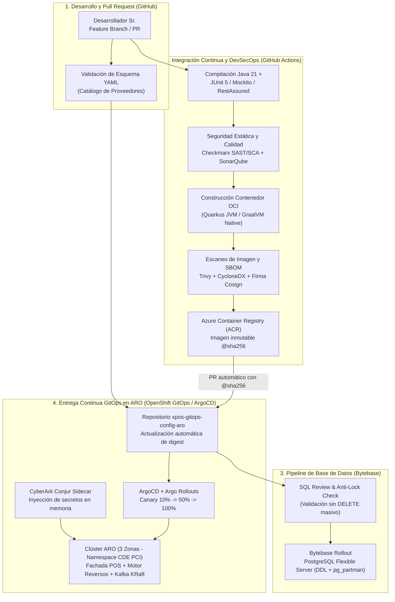
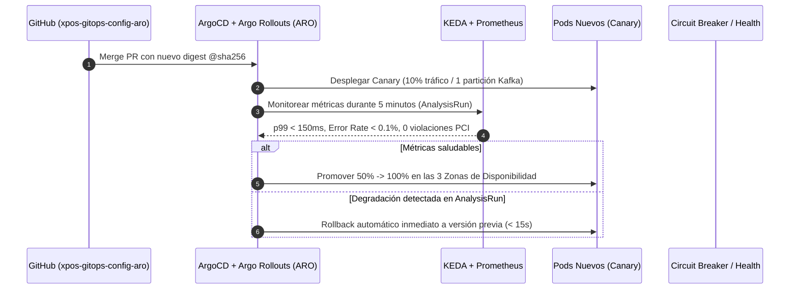

# Propuesta de Despliegue CI/CD, DevSecOps y Gobierno GitOps en ARO

**Fecha:** 2026-10-16  
**Versión:** 1.0  
**Alcance:** Pipelines de Integración Continua (CI), Entrega Continua GitOps (CD), Gobierno de Base de Datos (Bytebase), Seguridad de Cadena de Suministro (PCI-DSS 4.0) y Topología de Repositorios en GitHub.

---

## 1. Principios de Diseño CI/CD para Entorno PCI-DSS en ARO

1. **Separación estricta entre CI (Construcción/Verificación) y CD (Despliegue GitOps Pull-Based):**
   - Los runners de GitHub Actions **nunca** tienen credenciales de administrador (`cluster-admin`) hacia el clúster productivo de Azure Red Hat OpenShift (ARO) ni acceso directo a la red del CDE (Cardholder Data Environment).
   - El pipeline de CI compila, ejecuta pruebas, escanea con **Checkmarx / SonarQube / Trivy**, firma la imagen OCI con **Cosign**, publica el artefacto en el registro privado (ACR / Quay) y abre un Pull Request automático hacia el repositorio GitOps (`xpos-gitops-config-aro`).
   - **OpenShift GitOps (ArgoCD)** corriendo *dentro* de ARO detecta el commit aprobado y sincroniza el estado deseado.
2. **Inmutabilidad y Promoción de Artefactos por Digest (`sha256`):**
   - Una imagen de contenedor se construye **una sola vez** y se promueve entre `dev` $\rightarrow$ `qa` $\rightarrow$ `staging-pci` $\rightarrow$ `prod-pci` referenciando su digest inmutable (`@sha256:...`), nunca etiquetas mutables como `:latest`.
3. **Zero Secrets en Git y en Pipelines de Despliegue:**
   - Las credenciales operativas (certificados mTLS de proveedores, llaves OAuth, usuarios de PostgreSQL) viven exclusivamente en **CyberArk Conjur** y se inyectan en tiempo de ejecución mediante el sidecar/operador de Conjur en ARO.
4. **Gobierno de Base de Datos desacoplado del arranque de pods en Producción (Bytebase):**
   - Mientras que en el piloto local (`%op1`, `%op3`) Flyway puede ejecutar migraciones al arranque, en **Producción ARO** el usuario de aplicación (`xpos_app`) **solo tiene permiso `INSERT`/`SELECT`/`UPDATE` acotado** (y solo `INSERT` sobre `bitacora_auditoria`). Los cambios DDL y el mantenimiento de particiones se ejecutan vía **Bytebase** en una etapa previa al despliegue de los pods (*Expand-and-Contract pattern*).

---

## 2. Topología de Repositorios en GitHub

Para garantizar modularidad, aislamiento de permisos (CODEOWNERS por equipo de Arquitectura, Seguridad, DBA y Plataforma) y despliegues independientes, la plataforma se organiza en **5 repositorios especializados**:

| Repositorio en GitHub | Tipo | Responsabilidad Principal | Dueño / Aprobador (CODEOWNERS) |
| :--- | :--- | :--- | :--- |
| [`xpos-core-motor-transacciones`](https://github.com/castellconde/xpos-core-motor-transacciones) | Librería / Arquetipo Quarkus (Java 21) | Modelo canónico (`TransaccionCanonica`, `ResultadoCanonico`), puertos hexagonales, cliente de bitácora SHA-256 y enmascarador PCI-DSS reutilizable por cualquier servicio de proveedor. | Arquitectura & Core Integration |
| [`xpos-ms-fachada-pos`](https://github.com/castellconde/xpos-ms-fachada-pos) | Microservicio Quarkus (Java 21) | Única puerta de entrada de las ~50,000 cajas POS. Valida identidad mTLS `X-Forwarded-Client-Cert` (`RFC 8705`), `Idempotency-Key`, sanitiza payloads y publica en Kafka. | Equipo Integración POS |
| [`xpos-ms-motor-reversos`](https://github.com/castellconde/xpos-ms-motor-reversos) | Microservicio Quarkus (Java 21) + Piloto Local | Servicio de reversos sobre el motor genérico, adaptadores `REST`/`SOAP`/`ISO-8583` (`jPOS`), coordinación Circuit Breaker + pausa de Kafka, endpoints de soporte DLQ y depuración de particiones. | Equipo Pagos y Proveedores |
| [`xpos-ms-sandbox-proveedores`](https://github.com/castellconde/xpos-ms-sandbox-proveedores) | Microservicio Sandbox Quarkus (Java 21) | Emulador multiprotocolo (`ISO 8583` `0800`/`0200`/`0420`/`0421`, `SOAP` XML/Fault y `REST`) con reglas deterministas por folio (`-99`, `-68`, `-91`, `-94`) para desacoplar el gobierno de versiones de XPOS de los ambientes externos de proveedores. | QA / SDET & Release Governance |
| [`xpos-infra-aro-terraform`](https://github.com/castellconde/xpos-infra-aro-terraform) | Infraestructura como Código (Terraform + Operadores) | Aprovisionamiento de ARO en 3 zonas, Node Pools dedicados PCI/No-PCI, Azure Database for PostgreSQL Flexible Server (`pg_partman`, `pg_cron`, PgBouncer), Blob Storage WORM y operadores de Kafka KRaft / Keycloak. | Cloud Infrastructure & SecOps |
| [`xpos-gitops-config-aro`](https://github.com/castellconde/xpos-gitops-config-aro) | GitOps (ArgoCD + Kustomize + YAML Proveedores + Bytebase) | Manifiestos declarativos de despliegue por ambiente (`op1`, `op3`, `staging`, `prod-cde`), catálogo YAML de proveedores validado con JSON Schema, `ScaledObjects` de KEDA, `NetworkPolicies` PCI y DDL de Bytebase. | SRE / DevSecOps / DBA |

---

## 3. Arquitectura del Pipeline CI/CD End-to-End

---

## 4. Etapas Detalladas de los Pipelines

### 4.1 Pipeline de Microservicios (`xpos-ms-fachada-pos`, `xpos-ms-motor-reversos`)

| Etapa | Herramienta | Criterio de Aprobación (Quality / Security Gate) |
| :--- | :--- | :--- |
| **1. Build & Unit/Component Tests** | Maven 3.9 + GraalVM Java 21 + JUnit 5 | 100% de tests pasando (incluyendo pruebas de los 6 pasos del guion y pruebas negativas PCI/mTLS). Cobertura $\ge 80\%$. |
| **2. SAST & Code Quality** | Checkmarx + SonarQube | 0 vulnerabilidades Críticas o Altas (OWASP Top 10 / PCI-DSS Req 6.2). 0 secretos detectados en código (`gitleaks`). |
| **3. Dependency & SCA Scan** | OWASP Dependency-Check / Checkmarx SCA | Bloqueo automático si existe algún CVE con CVSS $\ge 7.0$ sin parche en dependencias transitivas. |
| **4. Container Build & Hardening** | Quarkus Jib / Docker Multistage (`UBI9 Minimal` non-root) | Ejecución obligatoria con usuario no privilegiado (`UID 185`), filesystem raíz de solo lectura (`readOnlyRootFilesystem: true`). |
| **5. Image Scan, SBOM & Signing** | Trivy + Syft (CycloneDX) + Cosign | Generación de SBOM adjunto a la imagen y firma criptográfica verificada por política Kyverno/Gatekeeper en ARO. |
| **6. GitOps Promotion** | GitHub Actions $\rightarrow$ PR en `xpos-gitops-config-aro` | Actualiza el `newTag` / `digest` en el overlay Kustomize del ambiente destino. |

### 4.2 Pipeline de Configuración en Caliente de Proveedores (`xpos-gitops-config-aro`)

La propuesta de arquitectura establece: *"La configuración DEBE vivir en Git como YAML con esquema validado al arrancar (GitOps), para que cada cambio quede revisado y trazable"*.

1. **Validación de Esquema en PR (`jsonschema` / `ajv` / `yq`):** Cada archivo `proveedores/<proveedor>.yaml` se valida contra `schemas/proveedor-schema.json` verificando:
   - Que los timeouts de lectura sean menores al SLA de la fachada.
   - Que la tabla de mapeo de códigos cubra obligatoriamente las 5 clases canónicas (`Exito`, `YaAplicado`, `ErrorReintentable`, `EstadoDesconocido`, `ErrorNegocio`).
   - Que **no** existan credenciales ni secretos en el YAML (solo referencias de alias en CyberArk Conjur, ej. `conjur://vault/pci/proveedores/prosa/mtls-cert`).
2. **Sincronización vía ConfigMap Inmutable y Recarga Controlada:** ArgoCD actualiza el `ConfigMap` versionado en ARO, recargando en caliente únicamente parámetros no sensibles (umbrales de Circuit Breaker, tabla de códigos).

### 4.3 Pipeline de Infraestructura (`xpos-infra-aro-terraform`)

1. **`terraform fmt -check` & `terraform validate`:** Verificación sintáctica de los módulos (`aro-cluster`, `postgresql-flexible-pci`, `storage-worm-bitacora`, `network-waf-edge`).
2. **Seguridad IaC (`tfsec` / `Checkov`):** Verifica que:
   - Azure PostgreSQL Flexible Server tenga `ssl_enforcement_enabled = true`, `tls_min_version = "TLS1_2"`, `zone_redundant` activo y `azure.extensions = "PG_CRON,PG_PARTMAN"`.
   - El contenedor de Blob Storage para archivo frío tenga política de inmutabilidad **WORM** (`immutability_policy` bloqueada por 13 meses para cumplir PCI-DSS 10.7).
   - Los Node Pools de cargas PCI tengan `taints` dedicados (`pci-cde=true:NoSchedule`).
3. **Plan en PR y Apply con Aprobación Dual:** El `terraform plan` se publica como comentario en el Pull Request y el `apply` requiere aprobación de Infraestructura y Seguridad.

### 4.4 Pipeline de Base de Datos con Bytebase

1. **Revisión Automática de SQL (SQL Review Policy):**
   - **Prohibido `DELETE FROM bitacora_auditoria`:** Bytebase rechaza cualquier script que intente hacer `DELETE` sobre la bitácora; solo permite el procedimiento almacenado / job de mantenimiento que ejecuta `DETACH PARTITION` + `DROP TABLE` previa validación de `control_particion_bitacora`.
   - **Verificación de `fillfactor = 100`** en nuevas particiones.
   - **Prohibición de bloqueos `ACCESS EXCLUSIVE` prolongados** en horario hábil sobre `reverso_transaccion`.

---

## 5. Estrategia de Despliegue Progresivo (Canary / Blue-Green) y Rollback en ARO

* **Cero Downtime durante despliegues del Servicio de Reversos:**
  - Uso de `PreStop` hook de 15 segundos y `terminationGracePeriodSeconds: 45` para que cada pod termine su Fase TX-2 antes de cerrar el consumidor de Kafka, evitando transacciones huérfanas o rebalanceos abruptos (usando *Cooperative Sticky Assignor* en Kafka).
